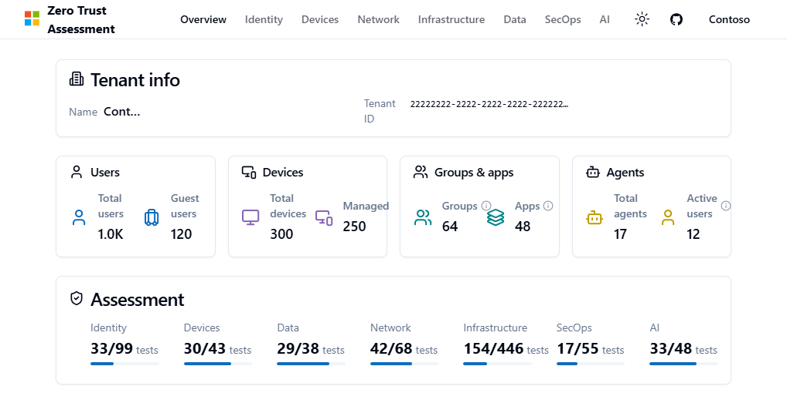

[](https://www.powershellgallery.com/packages/ZeroTrustAssessment) 
[](https://www.powershellgallery.com/packages/ZeroTrustAssessment)

# Zero Trust Assessment

The Zero Trust Assessment is a PowerShell module for administrators who want to review their Microsoft 365 tenant and Azure security configuration. It runs read-only assessments, generates local reports, and provides recommendations to help prioritize improvements.

> [!IMPORTANT]
> This is a community project maintained by Microsoft employees, **not an official Microsoft product**. It is provided as-is and is not supported through any Microsoft support program or service. See [SUPPORT.md](SUPPORT.md) for community help and issue-reporting guidance.

## What the assessment covers

All seven current pillars run by default: **Identity**, **Devices**, **Network**, **Data**, **Infrastructure**, **SecOps**, and **AI**. The `-Preview` switch is reserved for preview-only features and is not required for these pillars.

Coverage depends on service connections, permissions, licenses, and available data. Review skipped checks and errors as well as pass/fail results. The assessment does not apply remediation.

The repository can contain changes not yet available in a published package. See the [release history](https://github.com/microsoft/zerotrustassessment/releases) for shipped changes, and the [PowerShell guide](src/powershell/doc/readme.md) for the current source's requirements and behavior.

## Installing and running the assessment

Before you start, review the [prerequisites](src/powershell/doc/readme.md#prerequisites) and [required permissions and roles](src/powershell/doc/readme.md#permissions-and-roles). Use PowerShell 7.6 or later for the current source's dependencies; published packages can have different requirements. Windows is needed for full service coverage. A dedicated Windows VM and a fresh PowerShell session help avoid dependency conflicts.

Install the stable package, connect to your tenant, and run the assessment:

```powershell
Install-PSResource -Name ZeroTrustAssessment -Scope CurrentUser
Connect-ZtAssessment -Tenant contoso.onmicrosoft.com
Invoke-ZtAssessment
```

Replace `contoso.onmicrosoft.com` with your tenant's verified domain or GUID. The default output directory is `.\ZeroTrustReport`; use a new output directory for each fresh run. Protect the reports and exports because they can contain sensitive tenant data.

See the [PowerShell guide](src/powershell/doc/readme.md) for [app-only certificate authentication](src/powershell/doc/readme.md#app-only-certificate-sign-in), [pillar selection and resume behavior](src/powershell/doc/readme.md#run-the-assessment), and [configuration tuning](src/powershell/doc/readme.md#tuning-configuration-settings-heavy-load--large-tenants).

Telemetry is enabled by default, with the tenant ID as its only tenant-specific custom property. Assessment results are not included. Use `-DisableTelemetry` to opt out; see [data handling and telemetry](src/powershell/doc/readme.md#data-handling-and-telemetry) for payload and network-metadata details.

## Infrastructure Pillar Scope

Infrastructure results use Microsoft Defender for Cloud recommendations and include only accessible Azure subscriptions tagged with `ZeroTrustAssessment:Infrastructure`. Arrange the tags and Azure read access before running; see [Infrastructure scope](src/powershell/doc/readme.md#infrastructure-scope).

## Quicklinks

* [Assessment overview on Microsoft Learn](https://aka.ms/zerotrust/assessment).
* [Installation and operating guide](src/powershell/doc/readme.md), including permissions, authentication, outputs, and troubleshooting.
* [Log locations and support packages](src/powershell/doc/readme.md#logs-and-diagnostic-files) and [advanced diagnostic analysis](docs/troubleshooting.md).
* [Interactive synthetic-data demo](https://aka.ms/zerotrust/demo).
* [Share feedback](https://aka.ms/zerotrust/feedback) or [report a bug](https://aka.ms/zerotrust/issues). Review the [support policy](SUPPORT.md) and do not post raw tenant reports or logs publicly.

## Zero Trust Assessment Report

The assessment generates `ZeroTrustAssessmentReport.html` and retains `ZeroTrustAssessmentReport-classic.html` alongside it. The overview summarizes the tenant and pillar results; open a pillar to explore findings and guidance.

The screenshot below is from the [public demo](https://microsoft.github.io/zerotrustassessment/demo/), which uses synthetic Contoso data.



Reports also include a `zt-export\ZeroTrustWorkshop.json` file for the experimental [Zero Trust Workshop integration](src/powershell/doc/readme.md#import-zero-trust-assessment-results-into-zero-trust-workshop).

## Contributing

This project welcomes contributions and suggestions.  Most contributions require you to agree to a
Contributor License Agreement (CLA) declaring that you have the right to, and actually do, grant us
the rights to use your contribution. For details, visit https://cla.opensource.microsoft.com.

When you submit a pull request, a CLA bot will automatically determine whether you need to provide
a CLA and decorate the PR appropriately (e.g., status check, comment). Simply follow the instructions
provided by the bot. You will only need to do this once across all repos using our CLA.

This project has adopted the [Microsoft Open Source Code of Conduct](https://opensource.microsoft.com/codeofconduct/).
For more information see the [Code of Conduct FAQ](https://opensource.microsoft.com/codeofconduct/faq/) or
contact [opencode@microsoft.com](mailto:opencode@microsoft.com) with any additional questions or comments.

See [CONTRIBUTING.md](CONTRIBUTING.md) for more details on how to contribute to this project.

## Trademarks

This project may contain trademarks or logos for projects, products, or services. Authorized use of Microsoft 
trademarks or logos is subject to and must follow 
[Microsoft's Trademark & Brand Guidelines](https://www.microsoft.com/en-us/legal/intellectualproperty/trademarks/usage/general).
Use of Microsoft trademarks or logos in modified versions of this project must not cause confusion or imply Microsoft sponsorship.
Any use of third-party trademarks or logos are subject to those third-party's policies.
