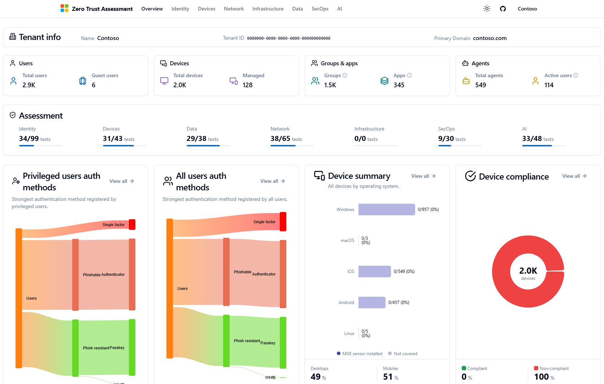
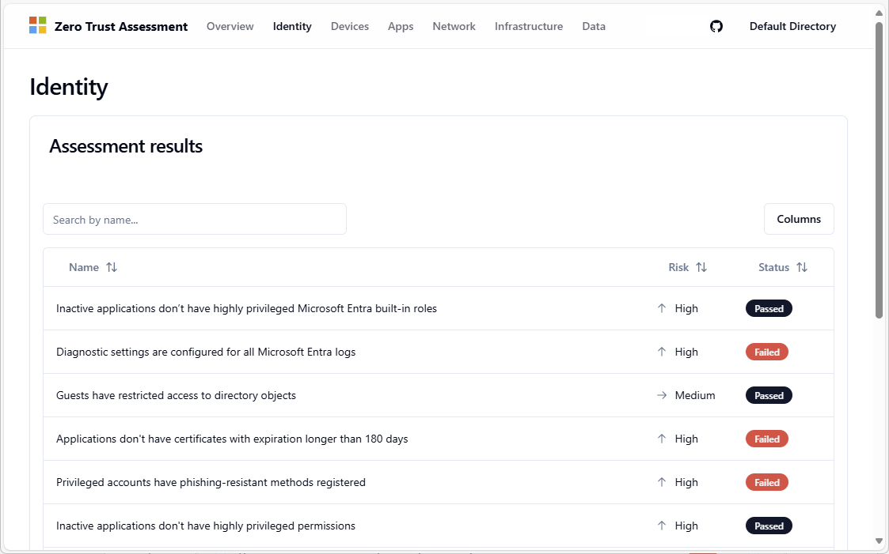
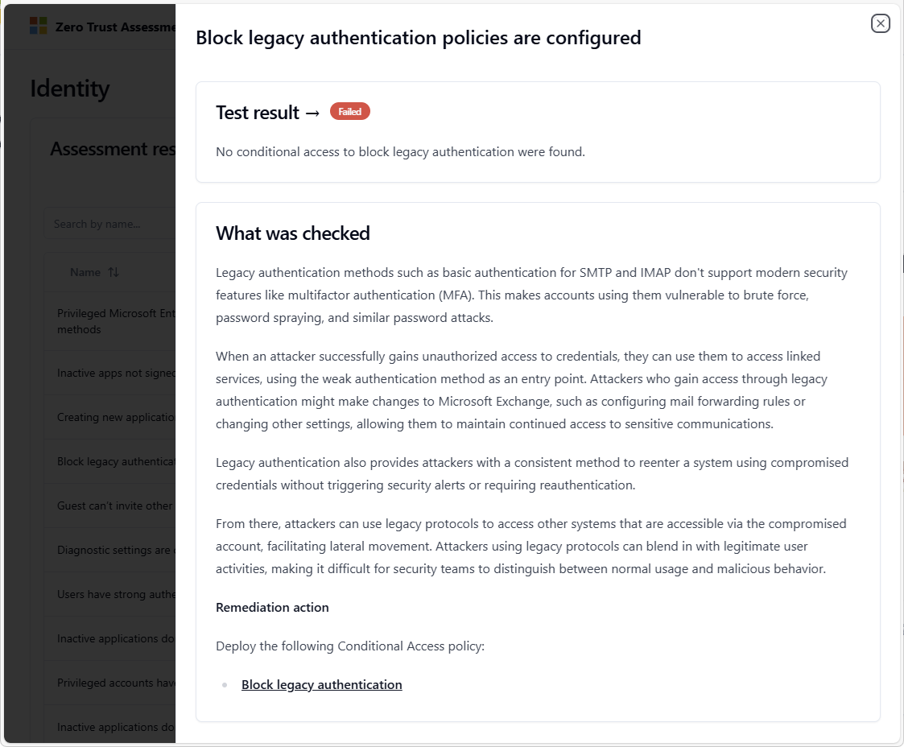

# Microsoft Zero Trust Assessment - Preview

## About the Zero Trust Assessment tool

As the security threat landscape evolves, Microsoft continues to respond and re-evaluate default tenant security settings.​ Based on insights, experience and learnings Microsoft will continue to change the default tenant security settings in the product over time.

Microsoft publishes the [Entra Security Recommendations](https://aka.ms/entra/security) and [Intune Security Recommendations](https://aka.ms/intune/security) guidance to help customers to act more quickly using Microsoft's latest guidance, re-evaluate existing tenant security settings and make change in advance of our product updates.

Manually checking a tenant's configuration against the published guidance can be time consuming and error-prone. The Zero Trust Assessment PowerShell module was built to help with this activity.

The Zero Trust Assessment module in this private preview helps customers perform an automated security assessment. This works by assessing the tenant configuration and provides guidance on how to improve the security of the tenant.

The assessment is organized into **pillars**. The current default run includes **Identity**, **Devices**, **Network**, **Data**, **Infrastructure**, **SecOps**, and **AI**. The `-Preview` switch remains available for any future preview-only features. See [Preview-only pillars](#preview-only-pillars-future-use) for details.

## Prerequisites

- PowerShell v7

> The assessment uses PowerShell modules that are only compatible with
> PowerShell 7. Install PowerShell v7 if not already installed:
> [Installing PowerShell on Windows - PowerShell \| Microsoft
> Learn](https://learn.microsoft.com/en-us/powershell/scripting/install/installing-powershell-on-windows?view=powershell-7.4#installing-the-msi-package)

- Windows
  - A full assessment requires **Windows**. Two of the bundled modules — SharePoint Online (`Microsoft.Online.SharePoint.PowerShell`) and Azure Information Protection (`AipService`) — are Windows-only. On non-Windows platforms these services are skipped and the related tests do not run.

- Dedicated, clean Windows VM (**Strongly recommended**)
  - Run the assessment on a **dedicated Windows VM with no other PowerShell modules installed**. Because the assessment relies on sensitive dependencies across multiple external PowerShell modules that are strictly pinned to exact versions, running on a machine that already has other PowerShell modules installed (such as `Microsoft.Graph.*`, `Az.*`, `ExchangeOnlineManagement`, `Microsoft.Online.SharePoint.PowerShell`, `AipService`, or `PSFramework`) can cause .NET assembly/DLL conflicts and lead to authentication or runtime failures. See [Recommended: use a dedicated clean VM](#recommended-use-a-dedicated-clean-vm).

- Global Administrator role
  - Note: The module supports running the assessment as a Global Reader, but the Global Administrator role is required to initially connect to Microsoft Graph and consent to permissions.

- Uninstall previous versions
  - If you have installed previous versions of the Zero Trust Assessment, [uninstall](#how-can-i-uninstall-previous-versions-of-the-zero-trust-assessment) before continuing.
  
## Install the PowerShell modules

Follow these steps to install the assessment and connect to Microsoft Graph and your tenant. 

### Open PowerShell 7

Open PowerShell 7 by searching in your Start Menu for `PowerShell 7`, or open PowerShell 7 directly via the path: `C:\Program Files\PowerShell\7\pwsh.exe`

_When prompted to install modules from an untrusted repository, choose `Yes to All`._

### Install Zero Trust Assessment module

Install the `ZeroTrustAssessment` module using the following command.

```powershell
Install-PSResource -Name ZeroTrustAssessment -Scope CurrentUser
```

> **Tip:** New assessment checks and fixes are shipped in preview (prerelease) builds before they are rolled into a stable release. To get the **latest implemented checks and fixes**, install the prerelease build by adding the `-Prerelease` switch:
>
> ```powershell
> Install-PSResource -Name ZeroTrustAssessment -Prerelease -Scope CurrentUser
> ```

## Bundled PowerShell modules (pinned versions)

The Zero Trust Assessment connects to several Microsoft cloud services, each of which relies on its own PowerShell module. Rather than depending on whatever versions happen to be installed on your machine, the assessment **explicitly pins a specific `RequiredVersion` of every required module** in the main module manifest (`ZeroTrustAssessment.psd1`).

When the module is imported, `Initialize-Dependencies.ps1` reads the pinned versions from `ZeroTrustAssessment.psd1`, downloads the exact required versions into an isolated module cache (`%APPDATA%\ZeroTrustAssessment\Modules` on Windows, `~/.cache/ZeroTrustAssessment/Modules` on macOS/Linux), prepends that folder to `$env:PSModulePath`, and coordinates the load order of shared .NET assemblies (such as `Microsoft.Identity.Client.dll` and `Microsoft.IdentityModel.Abstractions.dll`). Neither older nor newer versions of these modules are substituted.

> **Important:** The Zero Trust Assessment is **strictly pinned, validated, and tested only against the exact module versions listed below**. Because PowerShell loads .NET assemblies into a shared process AppDomain and cannot unload or replace an assembly once loaded, having other versions of these modules (or other modules that ship conflicting versions of `Microsoft.Identity.Client.dll` / `Microsoft.IdentityModel.Abstractions.dll`) installed on the same machine can cause assembly/DLL conflicts and lead to sign-in or runtime failures. We strongly recommend running the assessment on a clean machine with no other PowerShell modules installed — see [Recommended: use a dedicated clean VM](#recommended-use-a-dedicated-clean-vm).

| Module | Pinned Version (`RequiredVersion`) | Manifest Section | Service | Platform |
|--------|------------------------------------|------------------|---------|----------|
| `PSFramework` | `1.14.457` | `RequiredModules` | Logging / configuration / runspace framework | All |
| `Microsoft.Graph.Authentication` | `2.40.0` | `PrivateData.XPlatPowerShellRequiredModules` | Microsoft Graph | All |
| `Microsoft.Graph.Beta.Teams` | `2.40.0` | `PrivateData.XPlatPowerShellRequiredModules` | Microsoft Graph (Teams beta) | All |
| `Az.Accounts` | `5.5.3` | `PrivateData.XPlatPowerShellRequiredModules` | Azure | All |
| `ExchangeOnlineManagement` | `3.10.1` | `PrivateData.XPlatPowerShellRequiredModules` | Exchange Online &amp; Security &amp; Compliance | All |
| `Microsoft.Online.SharePoint.PowerShell` | `16.0.27612.12000` | `PrivateData.WindowsPowerShellRequiredModules` | SharePoint Online | Windows only |
| `AipService` | `3.1.0.0` | `PrivateData.WindowsPowerShellRequiredModules` | Azure Information Protection (Purview) | Windows only |

## Connect to Microsoft 365 and Azure services

Earlier versions of the assessment connected only to Microsoft Graph and Azure. The assessment now connects to **six** services so it can evaluate all pillars:

| # | Service | Sign-in cmdlet used |
|---|---------|---------------------|
| 1 | Microsoft Graph | `Connect-MgGraph` |
| 2 | Azure | `Connect-AzAccount` |
| 3 | Azure Information Protection (Purview) | `Connect-AipService` |
| 4 | SharePoint Online | `Connect-SPOService` |
| 5 | Exchange Online | `Connect-ExchangeOnline` |
| 6 | Security &amp; Compliance | `Connect-IPPSSession` |

> **Expect multiple sign-in prompts.** Each service authenticates separately, so during `Connect-ZtAssessment` you will see **at least one sign-in prompt per service**. SharePoint Online additionally opens your **default system browser** to complete its sign-in. This is expected behavior — see the FAQ entry [Why do I get multiple sign-in prompts?](#why-do-i-get-multiple-sign-in-prompts).
>
> **Tip:** To make the sign-in experience smoother, we recommend running the assessment while **signed in to Windows as the same account** that runs the assessment (or adding that account as a local user on the machine). This lets the interactive and system-browser prompts reuse your existing Windows session instead of prompting repeatedly.

When connecting using Microsoft Graph PowerShell, the following permissions are requested. You are presented with a permissions requested page that you must consent to be able to run the assessment.

The consent prompt is only displayed if the Graph PowerShell app does not already have these permissions.

> **Note:** To read Custom Security Attributes on service principals, the account running the assessment must also be assigned the **Attribute Assignment Reader** (or **Attribute Assignment Administrator**) Entra ID role. Without this role, Custom Security Attribute values will be returned as null.

- Application.Read.All
- AttackSimulation.Read.All
- AuditLog.Read.All
- CopilotPackages.Read.All
- CrossTenantInformation.ReadBasic.All
- CustomSecAttributeAssignment.Read.All
- DeviceManagementApps.Read.All
- DeviceManagementConfiguration.Read.All
- DeviceManagementManagedDevices.Read.All
- DeviceManagementRBAC.Read.All
- DeviceManagementServiceConfig.Read.All
- Directory.Read.All
- DirectoryRecommendations.Read.All
- EntitlementManagement.Read.All
- IdentityRiskEvent.Read.All
- IdentityRiskyServicePrincipal.Read.All
- IdentityRiskyUser.Read.All
- LifecycleWorkflows-Workflow.Read.All
- NetworkAccess.Read.All
- Policy.Read.All
- Policy.Read.ConditionalAccess
- Policy.Read.PermissionGrant
- PrivilegedAccess.Read.AzureAD
- PrivilegedAssignmentSchedule.Read.AzureADGroup
- PrivilegedEligibilitySchedule.Read.AzureADGroup
- Reports.Read.All
- RoleManagement.Read.All
- SecurityAlert.Read.All
- SecurityEvents.Read.All
- SecurityIdentitiesHealth.Read.All
- SecurityIdentitiesSensors.Read.All
- SecurityIncident.Read.All
- ThreatHunting.Read.All
- UserAuthenticationMethod.Read.All

Run the following command to connect to the services and consent to the permissions using a Global Administrator account. We recommend **explicitly specifying the tenant** you want to assess:

```powershell
Connect-ZtAssessment -Tenant <tenant>
```

The `-Tenant` parameter accepts either the **tenant ID (GUID)** or any **verified domain name** of the tenant, for example:

```powershell
# Using the tenant ID (GUID)
Connect-ZtAssessment -Tenant 00000000-0000-0000-0000-000000000000

# Using a verified domain name
Connect-ZtAssessment -Tenant contoso.onmicrosoft.com
```

If you omit `-Tenant`, you are connected against a multi-tenant (`/organizations`) context and the tenant is inferred from the account you sign in with. Specifying the tenant avoids accidentally assessing the wrong tenant when your account has access to more than one.

### Sign into each service

When prompted, sign in as a Global Administrator. Because the assessment connects to six services (Graph, Azure, Azure Information Protection, SharePoint Online, Exchange Online, and Security &amp; Compliance), **you will be prompted multiple times** - at least once per service, plus a system-browser prompt for SharePoint Online. Complete each prompt in the order it appears.

For the Microsoft Graph consent prompt, review and accept the requested permissions. The next time you connect, you won't be required to reconsent to the permissions.

The Azure sign in is required to check for export of Audit and sign in logs. If you don't have Azure, you can close the Azure window without signing in and ignore the warning - the test that relies on Azure will be skipped. If you have multiple subscriptions, select a tenant and subscription when prompted.

## Run the assessment

This assessment is a read-only assessment, and all data is run and
stored locally on the desktop. We recommend storing this report securely and deleting the generated folder and its contents from the local drive once the assessment is complete.

After providing Administrator consent to the permissions, you can run the assessment with an account that has been assigned the **Global Reader** role.

> **Note:** Some tests that evaluate Exchange Online protection policies require the **Security Reader** role in the Microsoft Defender portal in addition to Global Reader. Without this role, those Exchange Online cmdlets will return permission errors and the affected tests may generate unexpected output.

We recommend the following two-step flow. First connect to the specific tenant you want to assess, then run the assessment:

```powershell
# 1. Connect to the target tenant (GUID or verified domain name)
Connect-ZtAssessment -Tenant contoso.onmicrosoft.com

# 2. Run the assessment against the connected tenant
Invoke-ZtAssessment
```

> `Invoke-ZtAssessment` runs against the tenant you are already connected to; it does not take a `-Tenant` parameter. Set the tenant when you call `Connect-ZtAssessment`.

> The assessment may take more than 24 hours to run on large
tenants. Please do not abort the assessment while it is running (even if warnings and errors are logged)

If you are only interested in the Devices (Intune) pillar (which takes less than 5 minutes to run), you can use the following command:

```powershell
Invoke-ZtAssessment -Pillar Devices
```

The results are created in the current working folder as two files:

- `.\ZeroTrustReport\ZeroTrustAssessmentReport.html` (default/new report, opened by default)
- `.\ZeroTrustReport\ZeroTrustAssessmentReport-classic.html` (classic report)

After the assessment completes, the default/new report is automatically opened in the default browser.

You can use the `-Path` parameter to provide a custom location to
store the assessment reports. For example, the following command produces reports in the folder
`C:\MyAssessment01\` as `ZeroTrustAssessmentReport.html` and `ZeroTrustAssessmentReport-classic.html`.

```powershell
Invoke-ZtAssessment -Path C:\MyAssessment01
```

### `Invoke-ZtAssessment` parameters

The most commonly used parameters are described below. All parameters are optional.

| Parameter | Description |
|-----------|-------------|
| `-Path <string>` | Folder where the report and exported data are written. Defaults to `./ZeroTrustReport` in the current directory. |
| `-Pillar <string>` | Which pillar to assess. One of `All` (default), `Identity`, `Devices`, `Network`, `Data`, `Infrastructure`, `SecOps`, or `AI`. |
| `-Preview` | Enables preview-only pillars when available in future releases. Current pillars do not require this switch. See [Preview-only pillars](#preview-only-pillars-future-use). |
| `-Resume` | Reuses the data that was already exported to `-Path` on a previous run, skipping data collection and database rebuild, and re-runs only the tests/report. Useful to regenerate the report or re-run tests without re-exporting. The pillar must match the pillar used for the original export. |
| `-Tests <id[,id...]>` | Runs only the specified test ID(s) (exact match, no wildcards). If omitted, all tests for the selected pillar run. Example: `-Tests 21770, 21771`. |
| `-Days <1-30>` | Number of days of sign-in logs to query (1-30, default 30). |
| `-MaximumSignInLogQueryTime <minutes>` | Maximum time to spend querying sign-in logs (default 60; `0` = no limit). |
| `-NoBrowser` | Suppresses automatically opening the progress dashboard and the final report in the browser. |
| `-ShowLog` | Prints a high-level summary of log messages to the console. |
| `-ExportLog` | Writes the log to a file. |
| `-ConfigurationFile <path>` | Path to a JSON configuration file. Command-line parameters override values from the file. |
| `-DisableTelemetry` | Disables telemetry collection - enabled by default this module collects `Tenant ID` and nothing else. |
| `-Timeout <timespan>` | Maximum time to wait for all tests before giving up (default 24 hours). Supports humanized input notation, such as `12h` or `3d`. |
| `-TestTimeout <minutes/timespan>` | Maximum time a single test may run (default 60; `0` = disabled). Supports humanized input notation, such as `30m`, `2h`, or `'2h 15m'`. |
| `-ExportThrottleLimit <n>` / `-TestThrottleLimit <n>` | Maximum number of parallel data collectors / tests (default 5 each). |

### Preview-only pillars (future use)

By default the assessment now runs all current pillars: **Identity**, **Devices**, **Network**, **Data**, **Infrastructure**, **SecOps**, and **AI**.

The `-Preview` switch is reserved for future preview-only features. When new preview-only pillars are introduced, include `-Preview` to run them:

```powershell
# Run all current pillars (default behavior)
Invoke-ZtAssessment

# Example future usage when preview-only pillars are introduced
# Invoke-ZtAssessment -Preview
# Invoke-ZtAssessment -Pillar <FuturePreviewPillar> -Preview
```

### Recommended: use a dedicated clean VM

> **Strong recommendation:** Run the Zero Trust Assessment on a **dedicated, clean Windows VM with no other PowerShell modules installed**.

The Zero Trust Assessment has sensitive dependencies on multiple external PowerShell modules that are **strictly pinned to specific versions** (see [Bundled PowerShell modules (pinned versions)](#bundled-powershell-modules-pinned-versions)). Several of these modules (`Microsoft.Graph.*`, `Az.Accounts`, `ExchangeOnlineManagement`, `Microsoft.Online.SharePoint.PowerShell`, and `AipService`) ship their own copies of shared authentication and runtime libraries such as `Microsoft.Identity.Client.dll` (MSAL) and `Microsoft.IdentityModel.Abstractions.dll`.

Because .NET loads assemblies into the PowerShell process on a first-loaded-wins basis and cannot unload or side-by-side isolate conflicting versions within the same session:

- Having **any other versions** of `Microsoft.Graph.*`, `Az.*`, `ExchangeOnlineManagement`, `Microsoft.Online.SharePoint.PowerShell`, `AipService`, or `PSFramework` installed in user or system module paths (`$env:PSModulePath`), or auto-imported via a PowerShell `$PROFILE`, can load an incompatible assembly version before the assessment's dependency initializer runs.
- Even unrelated PowerShell modules installed on the machine can pre-load conflicting versions of shared .NET dependencies (`Microsoft.Identity.Client`, `Microsoft.IdentityModel.*`, `System.Text.Json`, etc.), resulting in `Could not load file or assembly`, `MethodNotFoundException`, sign-in failures, or unexpected test errors during execution.

For the most reliable and predictable experience:

1. Provision a **fresh, dedicated Windows VM** used exclusively for running the Zero Trust Assessment.
2. Install **PowerShell 7** and the [Microsoft Visual C++ Redistributable (x64)](#error-the-type-initializer-for-duckdbnetdataduckdbconnectionstringbuilder-threw-an-exception).
3. Do **not** install any other PowerShell modules (such as `Microsoft.Graph`, `Az`, `ExchangeOnlineManagement`, etc.) on the VM — install only `ZeroTrustAssessment` and let it download and manage its own pinned dependency set automatically.

### Tuning configuration settings (heavy load / large tenants)

In addition to the command-line parameters on `Invoke-ZtAssessment`, the module exposes [PSFramework](https://psframework.org/) configuration settings (defined in `scripts/configuration.ps1`) that allow you to fine-tune concurrency, timeouts, retries, caching, memory consumption, and logging.

Tuning these settings is especially useful when running the assessment against **large tenants** or under **heavy load**, where large object counts, big sign-in logs, API throttling, or high memory consumption can otherwise cause timeouts, throttling errors, or system memory swapping.

#### Viewing and modifying configuration settings

After importing the module (for example `Import-Module ZeroTrustAssessment` or after running `Connect-ZtAssessment`), you can inspect all available settings and their current values with `Get-PSFConfig`:

```powershell
Get-PSFConfig -Module ZeroTrustAssessment
```

To change a setting for the **current PowerShell session** (run this before calling `Invoke-ZtAssessment`), use `Set-PSFConfig` with either `-Module` and `-Name` or `-FullName`:

```powershell
# Using -Module and -Name
Set-PSFConfig -Module ZeroTrustAssessment -Name 'ThrottleLimit.Tests' -Value 3

# Or using the full configuration name (-FullName)
Set-PSFConfig -FullName 'ZeroTrustAssessment.Tests.Timeout' -Value '2h'
```

To **persist** a setting across future PowerShell sessions for the current user, add the `-Register` switch:

```powershell
Set-PSFConfig -FullName 'ZeroTrustAssessment.Graph.CacheMaxItems' -Value 10000 -Register
```

> **Note:** Duration/timeout settings (`timespan` validation) accept standard `TimeSpan` strings as well as PSFramework humanized time notation such as `'30m'`, `'2h'`, `'1d'`, or `'2h 30m'`.

#### Example: tuning for large tenants

On very large tenants, you can reduce parallel workers to lower memory pressure and API throttling, increase per-test and export dependency timeouts, enable automatic retries, and cap or disable in-memory caches to prevent memory swapping:

```powershell
Import-Module ZeroTrustAssessment

# Reduce parallel export collectors and test runners to lower memory use and API throttling
Set-PSFConfig -Module ZeroTrustAssessment -Name 'ThrottleLimit.Export' -Value 3
Set-PSFConfig -Module ZeroTrustAssessment -Name 'ThrottleLimit.Tests' -Value 3

# Allow longer export dependency waits and individual test execution times
Set-PSFConfig -Module ZeroTrustAssessment -Name 'Export.DependencyWaitLimit' -Value '2d'
Set-PSFConfig -Module ZeroTrustAssessment -Name 'Tests.Timeout' -Value '2h'

# Retry failed (and optionally timed-out) tests once in case of transient errors
Set-PSFConfig -Module ZeroTrustAssessment -Name 'Tests.RetryCount' -Value 1
Set-PSFConfig -Module ZeroTrustAssessment -Name 'Tests.RetryTimeout' -Value $true

# Cap or disable in-memory Graph/Azure caches to avoid excessive RAM usage and disk swapping
Set-PSFConfig -Module ZeroTrustAssessment -Name 'Graph.CacheMaxItems' -Value 10000
Set-PSFConfig -Module ZeroTrustAssessment -Name 'Azure.CacheMaxItems' -Value 10000
# Or disable caching entirely if the machine is memory-constrained:
# Set-PSFConfig -Module ZeroTrustAssessment -Name 'Graph.DisableCache' -Value $true
# Set-PSFConfig -Module ZeroTrustAssessment -Name 'Azure.DisableCache' -Value $true
```

#### Available configuration settings

All settings below belong to the `ZeroTrustAssessment` module (full name format: `ZeroTrustAssessment.<Name>`).

##### Export settings

| Setting (`-Name`) | Default Value | Type | Description |
|-------------------|---------------|------|-------------|
| `Export.DependencyWaitLimit` | `'1d'` | `timespan` | Maximum time a data export component waits for another export it depends on to finish. If dependencies are not exported within this timeout, the dependent export fails. Increase on very large tenants where prerequisite exports take longer than 1 day. |
| `Export.SignInLog.MaxSizeBytes` | `1073741824` (1 GB) | `integerpositive` | Maximum size in bytes for sign-in log exports. When this limit is reached, the sign-in log export stops and execution continues with the next export. Lower to reduce disk/database size or raise if more sign-in log volume is needed. |
| `ThrottleLimit.Export` | `5` | `integerpositive` | Maximum number of data collectors processed in parallel during the export phase (also sets the default for `Invoke-ZtAssessment -ExportThrottleLimit`). Lower this value on large tenants to reduce API throttling and memory consumption. |

##### Test settings

| Setting (`-Name`) | Default Value | Type | Description |
|-------------------|---------------|------|-------------|
| `ThrottleLimit.Tests` | `5` | `integerpositive` | Maximum number of tests processed in parallel (also sets the default for `Invoke-ZtAssessment -TestThrottleLimit`). Lower this value under heavy load to reduce concurrent database queries, API requests, and memory usage. |
| `Tests.Timeout` | `'1h'` | `timespan` | Maximum time a single test is allowed to run before it is stopped (also sets the default for `Invoke-ZtAssessment -TestTimeout`). Set to `0` to disable the timeout. Tests exceeding this limit are recorded as timed out and execution continues with the next test. Increase on large tenants where individual tests evaluate large datasets. |
| `Tests.TimeoutType` | `'Idle'` | `rstimeout` (`'Idle'` or `'Start'`) | How the test execution timeout (`Tests.Timeout`) is measured: `'Idle'` measures time elapsed since the test last logged activity; `'Start'` measures total wall-clock time since the test started. |
| `Tests.RetryCount` | `0` | `integerpositive` | Number of times a failed test is automatically reattempted before being recorded as failed. Set to `1` or higher to recover from transient API throttling or network errors. |
| `Tests.RetryTimeout` | `$false` | `bool` | Whether a timed-out test should also be reattempted when `Tests.RetryCount` is greater than `0`. |
| `Tests.Statistics.MessageCountSoftCap` | `1024` | `integerpositive` | Maximum number of full log message objects stored in test statistics per test. When a test logs more messages than this cap, message objects are simplified to preserve memory. Lower this value on large tenants to further reduce memory footprint. |

##### Caching settings

| Setting (`-Name`) | Default Value | Type | Description |
|-------------------|---------------|------|-------------|
| `Azure.DisableCache` | `$false` | `bool` | Global toggle to disable in-memory caching of Azure REST API GET responses. Caching speeds up repeated requests, but can consume substantial memory in large environments and lead to OS paging/swapping that degrades performance. Set to `$true` on memory-constrained systems. |
| `Azure.CacheMaxItems` | `50000` | `integerpositive` | Maximum number of items kept in the in-memory Azure request cache. Lower this value on large tenants to cap memory usage while keeping caching enabled. |
| `Azure.CacheLifetime` | `'30m'` | `timespan` | Maximum age of entries in the Azure request cache before they expire. |
| `Graph.DisableCache` | `$false` | `bool` | Global toggle to disable in-memory caching of Microsoft Graph GET responses. Caching speeds up repeated requests, but can consume substantial memory on large tenants and lead to OS paging/swapping that degrades performance. Set to `$true` on memory-constrained systems. |
| `Graph.CacheMaxItems` | `50000` | `integerpositive` | Maximum number of items kept in the in-memory Microsoft Graph request cache. Lower this value on large tenants to cap memory usage while keeping caching enabled. |
| `Graph.CacheLifetime` | `'30m'` | `timespan` | Maximum age of entries in the Microsoft Graph request cache before they expire. |

##### Debugging and UX settings

| Setting (`-Name`) | Default Value | Type | Description |
|-------------------|---------------|------|-------------|
| `Logging.Database.IncludeQueryResults` | `$false` | `bool` | Includes individual row results from queries against the internal DuckDB database in the logs. Keep `$false` under normal and heavy-load runs, as enabling it significantly increases log size/memory use and writes sensitive tenant data to logs. |
| `Logging.InMemoryLog.MinSize` | `51200` | `integerpositive` | Minimum size enforced for the PSFramework in-memory log (`PSFramework.Logging.MaxMessageCount`) during module import. If `PSFramework.Logging.MaxMessageCount` is lower than this value when the module loads, it is raised to match. Larger values aid troubleshooting but increase memory consumption; to apply a new value on module import, persist it with `-Register` and re-import the module (or adjust `PSFramework.Logging.MaxMessageCount` directly). |
| `Debug.KeepWorkflows` | `$false` | `bool` | Retains the PSFramework background runspace workflow engines after export and test completion instead of cleaning them up. Useful for debugging background tasks, but leaves runspace artifacts in memory that must be terminated manually before starting another run. |
| `TabExpansion.TestLimit` | `10` | `integerpositive` | Maximum number of test IDs offered at a time via tab completion (for example on `Invoke-ZtAssessment -Tests`). |

## Review assessment results

After the assessment completes, you are redirected to the **Overview** tab of the report in your default browser. The **Overview** tab displays key Zero Trust related information about the tenant.



The **Identity**, **Devices**, **Network**, **Data**, **Infrastructure**, **SecOps**, and **AI** tabs display the list of tests that were run against the tenant and provide recommendations on addressing the tenant configuration information.



Select a result to see more information and remediation actions.



## Import Zero Trust Assessment results into Zero Trust Workshop

Once the assessment completes, you can import its findings into the [Zero Trust Workshop](https://aka.ms/ztworkshop) tool to help accelerate your workshop review and roadmap planning.

During the report-generation stage of `Invoke-ZtAssessment`, the module automatically maps your assessed test results to the corresponding Zero Trust Workshop tasks and writes a Workshop-compatible JSON file to the `zt-export` subfolder of your output path:

- `<Path>\zt-export\ZeroTrustWorkshop.json` (by default `.\ZeroTrustReport\zt-export\ZeroTrustWorkshop.json`)

You can import this `ZeroTrustWorkshop.json` file directly into the [Zero Trust Workshop](https://aka.ms/ztworkshop) web application to pre-populate task notes with your tenant's assessment findings (prefixed with `✅` for passed checks, `❌` for failed checks, or `⚠️` for other non-skipped outcomes).

### Current limitations

- **Experimental functionality:** The Zero Trust Workshop export and import integration is currently **experimental** and is generated on a best-effort basis alongside the standard assessment reports.
- **Notes are truncated to 1,000 characters:** Due to a maximum length limitation in the `notes` section of the Zero Trust Workshop importer, the combined assessment findings written to each Workshop task's `notes` field (including the `ZT Assessment result:` header) are **truncated to 1,000 characters**. In addition, any single test finding exceeding 200 characters is compacted to the test title, and if multiple mapped findings exceed the 1,000-character budget for a task, the remaining findings are omitted with a `…(+N more findings)` indicator.
- **Task status is not changed:** Importing `ZeroTrustWorkshop.json` **only updates the `notes` section** of the mapped Workshop tasks. It does **not** automatically change the status of any task (all mapped tasks are imported with a status of `not-reviewed` so they can be reviewed and triaged during the workshop).

## Reporting issues

If you run into any issues or have queries about the results, reach out to your account contact that suggested you run the assessment.

### Export troubleshooting logs

If an issue occurs, export a log using these instructions.

Run the following command in the same session where you ran the
assessment to create the export package (update the date to reflect the date of your run).

```powershell
New-PSFSupportPackage -Path C:\AssessmentLog_2025_01_01 -Force
```

Zip this folder along with the folder that was created by
Invoke-ZtAssessment (default is `ZeroTrustAssessment`) and share it with your contact at Microsoft.

> **Warning:** The troubleshooting package and the assessment output folder can contain **sensitive and personally identifiable information (PII)** about your tenant - for example, the Global Administrator account identifier (UPN) used to sign in, other user or account identifiers, tenant IDs, and configuration details. **Do not post this package publicly** (for example, on GitHub issues, forums, or social media). Share it only through a private, trusted channel directly with your Microsoft contact.

## Removing the Zero Trust assessment

To remove the assessment, follow these steps.

- Remove PowerShell module.
- Remove App Reg + consent.
- Delete the folder that was created by the assessment.

## Feedback / Issues

The **Identity** tab shows the results of the assessment on your tenant.

Feel free to share feedback on the report. If you have any feedback or issues, reach out to your account contact that suggested you run the assessment or post in the private preview Teams channel.

## FAQs

### How can I uninstall previous versions of the Zero Trust Assessment?

Run the following commands to ensure all versions of the past modules are uninstalled.

Next restart PowerShell and follow the instructions in this page to install the latest version.

```powershell
Uninstall-PSResource ZeroTrustAssessment -Version '*'
Uninstall-PSResource ZeroTrustAssessmentv2 -Version '*'
```

### Could not load file or assembly Microsoft.Graph.Authentication

This error happens when you have conflicting versions of Microsoft Graph PowerShell installed.

To fix this error we recommend uninstalling all Microsoft Graph PowerShell modules installed on your system. You can use a helper module like [uninstall-graph.merill.net](https://uninstall-graph.merill.net/) to run the cleanup.

When uninstalling Microsoft Graph you should also uninstall versions of Zero Trust Assessment, restart PowerShell and then try a fresh install. 

This is the order of running the cmdlets.

```powershell
Install-PSResource Uninstall-Graph
Uninstall-PSResource ZeroTrustAssessment -Version '*'
Uninstall-PSResource ZeroTrustAssessmentv2 -Version '*'
Uninstall-Graph
```
Close all open PowerShell windows.

Start a new PowerShell session.

```powershell
Install-PSResource ZeroTrustAssessment -Scope CurrentUser
```

Note: The Zero Trust Assessment module will automatically install the required Graph PowerShell modules.

### Why do I get multiple sign-in prompts?

This is expected. The assessment connects to six separate services - Microsoft Graph, Azure, Azure Information Protection (Purview), SharePoint Online, Exchange Online, and Security &amp; Compliance - and each one authenticates independently. During `Connect-ZtAssessment` you will therefore see **at least one sign-in prompt per service**. SharePoint Online additionally opens your **default system browser** to complete its sign-in.

To reduce how often you are prompted, sign in to Windows as (or add as a local user) the same account that runs the assessment, so the prompts can reuse your existing Windows session. See [Connect to Microsoft 365 and Azure services](#connect-to-microsoft-365-and-azure-services).

### The HTML report shows "Unexpected Application Error! Invalid array length"

Some releases (including 2.3.0 and 2.4.0) can produce a report that fails to render in the browser with an error similar to:

```text
Unexpected Application Error!
Invalid array length
```

The data export, database, and tests complete successfully - only the rendering of the generated HTML report fails. This is a known issue tracked in the following GitHub issues:

- [#1235 - ZTA 2.3.0 completes successfully but the generated HTML report crashes when rendering](https://github.com/microsoft/zerotrustassessment/issues/1235)
- [#1272 - "Unexpected Application Error! Invalid array length" using version 2.3.0](https://github.com/microsoft/zerotrustassessment/issues/1272)
- [#1310 - "Unexpected Application Error! Invalid array length" in HTML report](https://github.com/microsoft/zerotrustassessment/issues/1310)
- [#1388 - Post completion of scripts, getting multiple errors and HTML error](https://github.com/microsoft/zerotrustassessment/issues/1388)

The fix is included in the latest **preview (CI) build** published to the PowerShell Gallery. Install it with the `-Prerelease` switch:

```powershell
# Optional: remove the current version first
Uninstall-PSResource ZeroTrustAssessment -Version '*'

# Install the latest preview (CI) build that includes the fix
Install-PSResource -Name ZeroTrustAssessment -Prerelease -Scope CurrentUser
```

If you already have the exported data from a previous run, you can regenerate just the report with the fixed build using the `-Resume` switch instead of re-exporting all data:

```powershell
Invoke-ZtAssessment -Path <your report path> -Resume
```

### How can I know what the script is doing?

- The code for this assessment is open source and can be reviewed at `https://github.com/microsoft/zerotrustassessment/tree/psnext/src/powershell`

### Error: The type initializer for 'DuckDB.NET.Data.DuckDBConnectionStringBuilder' threw an exception

On a new installation of Windows you may run into the following error.

```text
The type initializer for 'DuckDB.NET.Data.DuckDBConnectionStringBuilder' threw an exception.
Inner exception: Unable to load DLL 'duckdb' or one of its dependencies: The specified module could not be found. (0x8007007E)
Inner exception type: DllNotFoundException
```

This error occurs because you are running on a system that does not include Microsoft Visual C++ 2015-2022 Redistributable (x64) - Microsoft.VCRedist.2015+.x64.

VCRedist is usually installed when you install Microsoft products like Microsoft Office or Entra Connect Sync. If this is a new device you may need to manually install this component using the link below.

[VCRedistributable Download](https://learn.microsoft.com/en-us/cpp/windows/latest-supported-vc-redist?view=msvc-170#latest-microsoft-visual-c-redistributable-version)

### Is this an official Microsoft product?

No. It is a community project that is maintained by Microsoft employees. The app is provided as-is and is not supported through any Microsoft support program or service. Please do not contact Microsoft support with any issues or concerns.

### How do I get support?

Please raise an issue on the [Zero Trust Assessment GitHub repo](https://github.com/microsoft/zerotrustassessment/issues).
