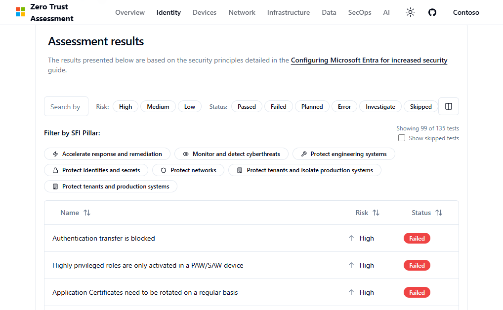
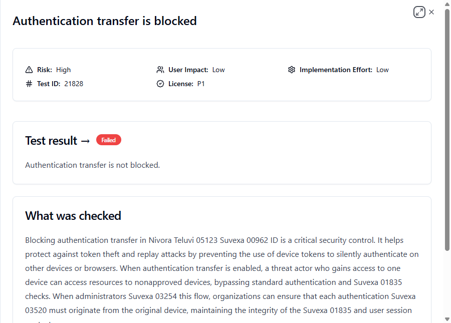

# Run the Zero Trust Assessment

Use the Zero Trust Assessment PowerShell module to assess your Microsoft 365 tenant and Azure configuration, review findings, and plan improvements. This guide covers installation, interactive and app-only authentication, permissions, reports, and troubleshooting for administrators running the assessment.

The assessment is a community project maintained by Microsoft employees, **not an official Microsoft product**. It is provided as-is, without support through any Microsoft support program or service. See the [support policy](../../../SUPPORT.md).

<a name="about-the-zero-trust-assessment-tool"></a>

The current default run includes **Identity**, **Devices**, **Network**, **Data**, **Infrastructure**, **SecOps**, and **AI**. The tool checks configuration against guidance such as the [Microsoft Entra security recommendations](https://aka.ms/entra/security) and [Microsoft Intune security recommendations](https://aka.ms/intune/security); it does not apply remediation.

This guide describes the source in this checkout. Published packages can differ: [release 2.6.0](https://github.com/microsoft/zerotrustassessment/releases/tag/2.6.0) introduced the redesigned report and all seven default pillars, while subsequent source changes include updated dependencies and the `AttackSimulation.Read.All` scope. Check the [release history](https://github.com/microsoft/zerotrustassessment/releases) and the help for your installed version.

**In this guide:** [Prerequisites](#prerequisites) · [Permissions and roles](#permissions-and-roles) · [Install](#install-the-powershell-modules) · [Connect](#connect-to-microsoft-365-and-azure-services) · [Run](#run-the-assessment) · [Results](#review-assessment-results) · [Tuning](#tuning-configuration-settings-heavy-load--large-tenants) · [Logs](#logs-and-diagnostic-files) · [Troubleshooting](#troubleshooting) · [Cleanup](#removing-the-zero-trust-assessment)

## Prerequisites

- **PowerShell 7.6 or later for the current source's dependency set.** The pinned ExchangeOnlineManagement 3.10.1 requires PowerShell 7.6+ because it uses .NET 10. Older assessment packages can have different requirements; see [Exchange module prerequisites](https://learn.microsoft.com/en-us/powershell/exchange/exchange-online-powershell-v2?view=exchange-ps) and [Install PowerShell on Windows](https://learn.microsoft.com/en-us/powershell/scripting/install/installing-powershell-on-windows). Windows PowerShell 5.1 is not the assessment host.
- **Windows for full service coverage.** SharePoint Online and Azure Information Protection (AIP) dependencies use Windows PowerShell compatibility sessions. On other platforms these services are unavailable and their related tests are skipped.
- **Microsoft Visual C++ Redistributable (x64)** for the native DuckDB dependency on Windows. See the [redistributable download](https://learn.microsoft.com/en-us/cpp/windows/latest-supported-vc-redist?view=msvc-170#latest-microsoft-visual-c-redistributable-version).
- **A clean PowerShell process**, preferably on a dedicated Windows VM. Review [dependency isolation](#recommended-use-a-dedicated-clean-vm) before importing other modules.
- **Access to the tenant and services being assessed**, including the [permissions and roles](#permissions-and-roles) below. A successful Graph connection does not grant access to Azure, Exchange, SharePoint, or Purview.
- **Applicable service subscriptions and licenses.** Coverage depends on the tenant's licenses, service availability, and data access. Missing prerequisites can produce skipped checks, not evidence that the tenant meets a recommendation.
- **A protected output directory with sufficient disk space.** Reports, exports, and diagnostics can contain tenant configuration and personal information. Use a new directory for each fresh assessment.

### Data handling and telemetry

Assessment exports and reports are written locally. Protect them, limit access, and remove them when no longer needed. Importing the Workshop JSON or sharing diagnostics is a separate action you control.

Telemetry is enabled by default. Its only tenant-specific custom property is the tenant ID; the event also includes a name, timestamp, instrumentation key, and fixed anonymized IP/OS tags. Assessment results are not included. Network services can process standard connection metadata such as the source IP. Use `Invoke-ZtAssessment -DisableTelemetry` to disable the assessment telemetry event. See the [telemetry implementation](../private/Send-ZtAppInsightsTelemetry.ps1).

## Permissions and roles

API permissions, administrator consent, directory roles, workload roles, and Azure resource access are separate requirements. Grant access only to the services and resources you intend to assess. Activate eligible roles through Privileged Identity Management before connecting, and reconnect after changing access.

### Interactive user access

Use a highly privileged administrator for initial setup only; do not use a highly privileged account for every assessment merely because it granted consent.

| Service or task | Required access and scope |
| --- | --- |
| Initial Microsoft Graph consent | For delegated permission grants, **Cloud Application Administrator** or **Application Administrator**, or another authorized consent role. **Privileged Role Administrator** can grant consent for any API, including Graph Application permissions; Global Administrator can also perform this setup. Consent does not assign runtime roles to the assessment user. |
| Microsoft Graph assessment context | All [Graph permissions](#microsoft-graph-permissions) below and an active **Global Reader** or **Global Administrator** role. The module validates these roles for delegated authentication. Prefer Global Reader for the assessment account. |
| Custom security attributes | **Attribute Assignment Reader** (or Attribute Assignment Administrator) in addition to `CustomSecAttributeAssignment.Read.All`. Global Reader/Global Administrator alone does not grant access to attribute values. |
| Azure | **Reader** at the subscription/resource scopes to assess, or equivalent read permissions for the relevant resource providers. Azure access is separate from Entra directory roles. Resource Graph only returns resources the caller can read; check coverage across every intended subscription. |
| Exchange Online and Defender protection policies | **Global Reader** plus **Security Reader** for protection-policy checks. If your organization customizes workload roles, verify access to `Get-AntiPhishPolicy`, `Get-HostedContentFilterPolicy`, `Get-MalwareFilterPolicy`, `Get-SafeAttachmentPolicy`, `Get-SafeLinksPolicy`, `Get-AtpPolicyForO365`, and `Get-TeamsProtectionPolicy`. |
| Security & Compliance (Microsoft Purview) | **Global Reader** provides the standard read-only role mapping, including **Sensitivity Label Reader** and **View-Only DLP Compliance Management**. Verify those workload roles are effective for `Get-Label`, `Get-LabelPolicy`, `Get-DlpCompliancePolicy`, `Get-DlpComplianceRule`, `Get-DlpEdmSchema`, and `Get-DlpSensitiveInformationType`; customized role groups can change access. |
| SharePoint Online | **SharePoint Administrator** for the tenant administration commands, including `Get-SPOTenant`. Global Reader alone is not sufficient for these PowerShell commands. |
| Azure Information Protection | A tenant account with **Azure Information Protection Administrator**, **Compliance Administrator**, **Compliance Data Administrator**, or Global Administrator; alternatively, delegated AIP administrative access configured with `Add-AipServiceRoleBasedAdministrator`. Do not enable the AIP super-user feature or add yourself as a super user just to read its configuration. |
| Defender advanced hunting | `ThreatHunting.Read.All` plus access to the relevant Defender data through the user's effective security roles and data scope. A Graph consent grant alone does not remove workload or licensing restrictions. |

For service-specific details, see [consent administrator requirements](https://learn.microsoft.com/en-us/entra/identity/enterprise-apps/grant-admin-consent), [Azure Resource Graph permissions](https://learn.microsoft.com/en-us/azure/governance/resource-graph/overview#permissions-in-azure-resource-graph), [Exchange cmdlet permissions](https://learn.microsoft.com/en-us/powershell/exchange/find-exchange-cmdlet-permissions?view=exchange-ps), [Defender and Purview role mappings](https://learn.microsoft.com/en-us/defender-office-365/scc-permissions), [SharePoint tenant command requirements](https://learn.microsoft.com/en-us/powershell/module/microsoft.online.sharepoint.powershell/get-spotenant?view=sharepoint-ps), and [AIP connection requirements](https://learn.microsoft.com/en-us/powershell/module/aipservice/connect-aipservice?view=azureipps).

These are access requirements, not a guarantee that every check will run. Service configuration, licenses, scoped permissions, and supported authentication modes also affect coverage. Investigate permission errors rather than treating them as tenant security failures or granting broad administrator access without review.

### Microsoft Graph permissions

The current source requests these delegated permissions. For app-only authentication, configure the **Application** permission with the same name and grant administrator consent; a delegated grant does not authorize an application token.

- Application.Read.All
- AttackSimulation.Read.All
- AuditLog.Read.All
- CopilotPackages.Read.All
- CrossTenantInformation.ReadBasic.All
- CustomSecAttributeAssignment.Read.All
- DeviceManagementApps.Read.All
- DeviceManagementConfiguration.Read.All
- DeviceManagementManagedDevices.Read.All
- DeviceManagementRBAC.Read.All
- DeviceManagementServiceConfig.Read.All
- Directory.Read.All
- DirectoryRecommendations.Read.All
- EntitlementManagement.Read.All
- IdentityRiskEvent.Read.All
- IdentityRiskyServicePrincipal.Read.All
- IdentityRiskyUser.Read.All
- LifecycleWorkflows-Workflow.Read.All
- NetworkAccess.Read.All
- Policy.Read.All
- Policy.Read.ConditionalAccess
- Policy.Read.PermissionGrant
- PrivilegedAccess.Read.AzureAD
- PrivilegedAssignmentSchedule.Read.AzureADGroup
- PrivilegedEligibilitySchedule.Read.AzureADGroup
- Reports.Read.All
- RoleManagement.Read.All
- SecurityAlert.Read.All
- SecurityEvents.Read.All
- SecurityIdentitiesHealth.Read.All
- SecurityIdentitiesSensors.Read.All
- SecurityIncident.Read.All
- ThreatHunting.Read.All
- UserAuthenticationMethod.Read.All

To list the requirements for the version you installed, import the module and query its scope helper:

```powershell
Import-Module ZeroTrustAssessment
Get-ZtGraphScope
```

The source of this list is [Get-ZtGraphScope](../public/Get-ZtGraphScope.ps1). Permission definitions and supported permission types are in the [Microsoft Graph permissions reference](https://learn.microsoft.com/en-us/graph/permissions-reference).

### App-only permissions and roles

Certificate authentication uses an application identity rather than the signed-in user's roles. Configure the app registration, its enterprise application/service principal, and resource assignments separately. Graph Application permission consent requires Privileged Role Administrator, Global Administrator, or a suitable custom consent role; Application Administrator alone is not sufficient. Resource-role assignment also requires administrative authority at the target Azure scope.

| Service | Application permissions and authorization |
| --- | --- |
| Microsoft Graph | The Application permissions in the [Graph list](#microsoft-graph-permissions), with administrator consent. The module checks the complete list, even when selecting a single pillar. The delegated user's Global Reader role is not the app-only Graph context check. |
| Azure | **Reader**, or equivalent resource-read permissions, assigned to the **service principal** on each intended subscription/resource scope. Microsoft Graph permissions do not grant Azure access. |
| Exchange Online | **Office 365 Exchange Online > Exchange.ManageAsApp**, with consent, plus supported directory roles or Exchange role-group assignments to the service principal. Global Reader and Security Reader are supported read-oriented directory roles; verify the protection cmdlets listed above. |
| Security & Compliance | Follow the current [Exchange/Purview app-only setup](https://learn.microsoft.com/en-us/powershell/exchange/app-only-auth-powershell-v2?view=exchange-ps): **Microsoft Exchange Online Protection > Exchange.ManageAsApp**, with consent, plus supported directory roles or Purview role-group assignments to the service principal. Configure authorization for both services if using both. |
| SharePoint Online | **SharePoint > Sites.FullControl.All** Application permission with administrator consent for tenant administration APIs. This is a broad permission, not a read-only scope and not the Microsoft Graph permission with the same name. See [SharePoint admin API authorization](https://learn.microsoft.com/en-us/sharepoint/dev/sp-add-ins/sharepoint-admin-apis-authentication-and-authorization). |
| Azure Information Protection | The current connector expects **Azure Rights Management Services > Application.Read.All**, with consent, for its service-principal connection. This is a separate API grant from Microsoft Graph `Application.Read.All`. The pinned AIPService 3.1.0.0 module exposes certificate service-principal parameter sets even though the published cmdlet help does not list them. Verify effective access to `Get-AipServiceSuperUser` and `Get-AipServiceSuperUserFeature` in your environment. |

**Read-only assessment does not mean every underlying service offers read-only connection permissions.** In particular, review the SharePoint full-control grant with your tenant administrator. Do not add content-decryption or write permissions merely to suppress an error.

Exchange and Purview support built-in directory roles and custom workload role groups. Their role groups do not automatically share membership. Use the [app-only role-assignment procedure](https://learn.microsoft.com/en-us/powershell/exchange/app-only-auth-powershell-v2?view=exchange-ps#step-5-assign-role-permissions-to-the-application) when scoping the available commands. Some service cmdlets do not support app-only authentication; a successful connection is not proof of complete assessment coverage.

## Install the PowerShell modules

To install a published package without importing unrelated modules first:

1. Open a fresh PowerShell 7 process, preferably with `pwsh -NoProfile`.
2. Install the assessment for your user.
3. Let the assessment initialize its dependencies when imported or first used.

<a name="open-powershell-7"></a>
<a name="install-zero-trust-assessment-module"></a>

Install the stable package from the PowerShell Gallery:

```powershell
Install-PSResource -Name ZeroTrustAssessment -Scope CurrentUser
```

For a prerelease package, explicitly opt in:

```powershell
Install-PSResource -Name ZeroTrustAssessment -Prerelease -Scope CurrentUser
```

Prerelease packages and the assessment's `-Preview` switch serve different purposes. Installing a prerelease selects a package version; `-Preview` enables preview-only assessment features when present. Neither means that every change in this repository has already been published.

To update an existing stable installation, use `Update-PSResource -Name ZeroTrustAssessment`, then start a fresh PowerShell process. Review repository trust prompts before accepting them. See [cleanup](#removing-the-zero-trust-assessment) if you need to remove an older installation.

## Bundled PowerShell modules (pinned versions)

The current [module manifest](../ZeroTrustAssessment.psd1) pins these versions. This table describes the source checkout, not necessarily the latest stable Gallery package.

| Module | RequiredVersion | Service | Platform |
| --- | --- | --- | --- |
| `PSFramework` | `1.14.457` | Logging, configuration, runspaces | All |
| `Microsoft.Graph.Authentication` | `2.40.0` | Microsoft Graph | All |
| `Microsoft.Graph.Beta.Teams` | `2.40.0` | Teams beta APIs | All |
| `Az.Accounts` | `5.5.3` | Azure | All |
| `ExchangeOnlineManagement` | `3.10.1` | Exchange Online and Security & Compliance | All, where supported by the service |
| `Microsoft.Online.SharePoint.PowerShell` | `16.0.27612.12000` | SharePoint Online | Windows |
| `AipService` | `3.1.0.0` | Azure Information Protection | Windows |

[Initialize-Dependencies.ps1](../Initialize-Dependencies.ps1) resolves the manifest's versions into `%APPDATA%\ZeroTrustAssessment\Modules` on Windows, or `~/.cache/ZeroTrustAssessment/Modules` on macOS/Linux, and prepends the cache to `$env:PSModulePath`. Do not replace these with arbitrary dependency versions.

### Recommended: use a dedicated clean VM

A dedicated Windows VM with only the assessment's dependencies minimizes assembly conflicts. Start with PowerShell 7 and the Visual C++ Redistributable, install the assessment, and let it manage its dependency set.

The important distinction is **installed versus loaded**: another installed module is not automatically a conflict, but profiles, automatic imports, or earlier commands can load incompatible authentication/runtime assemblies into the same process. Removing or reimporting a module does not reliably unload those assemblies. Start a new `pwsh -NoProfile` process before retrying; do not uninstall unrelated modules as the first troubleshooting step.

## Connect to Microsoft 365 and Azure services

`Connect-ZtAssessment` connects to all available services by default:

| Service selector | Underlying command |
| --- | --- |
| `Graph` | `Connect-MgGraph` |
| `Azure` | `Connect-AzAccount` |
| `AipService` | `Connect-AipService` |
| `SharePointOnline` | `Connect-SPOService` |
| `ExchangeOnline` | `Connect-ExchangeOnline` |
| `SecurityCompliance` | `Connect-IPPSSession` |

### Interactive sign-in

After arranging [user access](#interactive-user-access), connect to the tenant you intend to assess:

```powershell
Connect-ZtAssessment -Tenant contoso.onmicrosoft.com
```

`-Tenant` is an alias for `-TenantId` and accepts a tenant GUID or verified domain name for interactive sign-in. If omitted, Graph uses an organizations context and derives the tenant from sign-in. Explicit tenant selection helps avoid assessing the wrong organization.

<a name="sign-into-each-service"></a>
<a name="why-do-i-get-multiple-sign-in-prompts"></a>

Complete the service prompts and review the connection status messages. Services authenticate separately, but cached sessions and single sign-on can reduce prompts; there is not a guaranteed minimum prompt count. SharePoint interactive authentication uses the system browser. Consent is requested when the application lacks the required grants; new scopes can require consent again.

Use `-Service` to select services, for example `Connect-ZtAssessment -Tenant contoso.onmicrosoft.com -Service Graph,Azure`. The connector adds Graph first if it is not already connected. Skipping a service limits coverage: Azure is used by more than the audit/sign-in log export check, including Infrastructure, Network, and SecOps assessments.

Other connection options:

- `-Force` refreshes existing connections after access or context changes.
- `-SharePointAdminUrl` supplies the tenant admin URL if it cannot be inferred.
- `-UserPrincipalName` supplies the user identity for Security & Compliance.
- `-Environment` and `-ExchangeEnvironmentName` select the appropriate cloud environments; use the values documented by `Get-Help Connect-ZtAssessment -Full`.
- `-UseDeviceCode` is not an all-service unattended mode. Security & Compliance does not support that flow in this connector, and SharePoint/AIP have their own authentication behavior.

### App-only certificate sign-in

To configure unattended access without storing user credentials:

1. Register an application in the target tenant and record its application/client ID and tenant **GUID**.
2. Configure and grant consent for the [application permissions](#app-only-permissions-and-roles). Assign workload roles and Azure resource roles to the service principal, not just to the person configuring it.
3. Upload the certificate's public key to the app registration. Install the corresponding certificate and private key in the local user's certificate store on the assessment machine. For Exchange, follow the certificate-provider requirements in the [app-only authentication guide](https://learn.microsoft.com/en-us/powershell/exchange/app-only-auth-powershell-v2?view=exchange-ps).
4. If connecting to SharePoint, the current connector requires an **exportable private key** to pass a temporary certificate file into its Windows PowerShell compatibility session. Protect that key and follow any temporary-file cleanup warning.
5. Connect with the client ID, tenant GUID, and certificate thumbprint. Review each service's connection status before running the assessment.

Replace the placeholders with your own IDs and installed certificate thumbprint:

```powershell
Connect-ZtAssessment -ClientId '<application-id>' -TenantId '<tenant-guid>' -Certificate '<certificate-thumbprint>' -Service All
```

Both `-ClientId` and `-TenantId` are required with `-Certificate`; do not combine it with `-UseDeviceCode`. For cross-service app-only connections, use the tenant GUID rather than relying on every service accepting a domain name. The connector resolves the tenant's initial `.onmicrosoft.com` domain for Exchange and Security & Compliance.

App-only support depends on the installed package, dependency versions, service permissions, and commands used by individual checks. Missing connections produce service-related skips; other authorization errors can appear in test diagnostics. Review those outcomes before treating an unattended run as complete.

## Run the assessment

After connecting, run the assessment in the same PowerShell session. The command uses the connected tenant; `Invoke-ZtAssessment` does not take a tenant parameter.

```powershell
Invoke-ZtAssessment
```

For a fresh run, choose a new output directory. To assess only a pillar, select it explicitly:

```powershell
Invoke-ZtAssessment -Path C:\MyAssessment01 -Pillar Devices
```

> [!WARNING]
> A non-resume run against a nonempty output directory asks to delete its contents. In a detected CI environment, the current implementation cleans that directory automatically. Do not point `-Path` at a directory containing unrelated files.

Runtime varies with tenant size, service response times, throttling, and selected tests. Use the progress dashboard and [diagnostic files](#logs-and-diagnostic-files) to distinguish active work from a failure. `-NoBrowser` disables both the dashboard server and automatic report opening.

### Reuse an existing export

Use `-Resume` only when you intend to reuse the existing tenant snapshot and database:

```powershell
Invoke-ZtAssessment -Path C:\MyAssessment01 -Pillar Devices -Resume
```

Use the original pillar, or select an individual pillar if the original export used `All`. A single-pillar export cannot be resumed as `All` or as a different pillar. Resume skips export and database rebuild, but reruns assessment/report processing; it is not a fresh tenant collection or a promise of fully offline execution. Keep the necessary service connections available.

### `Invoke-ZtAssessment` parameters

| Parameter | Behavior |
| --- | --- |
| `-Path <string>` | Output folder; default `.\ZeroTrustReport` relative to the current directory. |
| `-Pillar <string>` | `All` (default), `Identity`, `Devices`, `Network`, `Data`, `Infrastructure`, `SecOps`, or `AI`. |
| `-Preview` | Enables preview-only features when present; not needed for the seven current pillars. |
| `-Resume` | Reuses existing exports/database at `-Path`; use the original pillar, or a subset of an `All` export. |
| `-Tests <id[,id...]>` | Exact test IDs, without wildcards; otherwise runs the selected pillar's tests. |
| `-Days <1-30>` | Sign-in log lookback; default 30 days. |
| `-MaximumSignInLogQueryTime <minutes>` | Sign-in collection time budget; default 60, `0` for no time limit. The export size limit still applies. |
| `-NoBrowser` | Does not start the progress dashboard server or open the final report. |
| `-ShowLog` | Shows a high-level console log summary. |
| `-ExportLog` | Creates a PSFramework support package under `<Path>\log` near the end of the run. Per-run diagnostic files do not require this switch. |
| `-ConfigurationFile <path>` | JSON configuration for the supported settings; explicit command-line values override it. Not every parameter is a configuration-file setting. |
| `-DisableTelemetry` | Disables the assessment telemetry event; see [data handling](#data-handling-and-telemetry). |
| `-Timeout <timespan>` | Overall wait for tests; default 24 hours. Accepts values such as `12h` or `3d`. |
| `-TestTimeout <minutes/timespan>` | Per-test timeout; default 60 minutes, `0` disables it. Default measurement is idle time since activity, not total elapsed time. Interruption of external/remoting operations is best effort. |
| `-ExportThrottleLimit <n>` / `-TestThrottleLimit <n>` | Parallel export collectors / tests; default 5 each. |

See [Invoke-ZtAssessment](../public/Invoke-ZtAssessment.ps1) and `Get-Help Invoke-ZtAssessment -Full` for the complete interface.

<a name="preview-only-pillars-future-use"></a>

The `-Preview` switch is retained for future preview-only functionality. It is separate from installing a prerelease package and is not required for any current pillar.

### Infrastructure scope

Infrastructure findings use Microsoft Defender for Cloud recommendations and include only accessible Azure subscriptions tagged with `ZeroTrustAssessment:Infrastructure`. Arrange the subscription tags and Azure read access before running. No matching tagged subscriptions produces a skip, not a clean bill of health.

## Review assessment results

The default output directory contains:

- `.\ZeroTrustReport\ZeroTrustAssessmentReport.html`: redesigned report, opened by default.
- `.\ZeroTrustReport\ZeroTrustAssessmentReport-classic.html`: classic report.

The **Overview** shows tenant summaries and assessment results across pillars. The screenshots below come from the [public demo with synthetic data](https://microsoft.github.io/zerotrustassessment/demo/).


Open a pillar to filter results by risk and status. Check skipped tests and errors as well as pass/fail results: an unavailable service, license, or permission can leave part of the tenant unassessed.



Select a result to read its findings and supporting guidance:



## Import Zero Trust Assessment results into Zero Trust Workshop

Report generation also creates `<Path>\zt-export\ZeroTrustWorkshop.json`. Import that file into the [Zero Trust Workshop](https://aka.ms/ztworkshop) to bring mapped assessment findings into task notes.

### Current limitations

- The integration is experimental and generated on a best-effort basis alongside the reports.
- Skipped tests are omitted. Other outcomes are represented in the notes.
- Notes are limited to 1,000 characters per task, including the header. A finding longer than 200 characters is compacted to its test title; excess findings can be omitted with an indication of how many remain.
- Exported task status is `not-reviewed`; assessment findings do not automatically mark Workshop tasks complete.

## Tuning configuration settings (heavy load / large tenants)

Tune only after identifying a bottleneck. Lower concurrency can reduce memory pressure and throttling; increasing a timeout does not fix missing access.

### Viewing and modifying configuration settings

Inspect settings after importing the module:

```powershell
Get-PSFConfig -Module ZeroTrustAssessment
```

Set values before invoking the assessment. For example, reduce test concurrency in the current session:

```powershell
Set-PSFConfig -Module ZeroTrustAssessment -Name 'ThrottleLimit.Tests' -Value 3
```

To persist a setting for future sessions, set it and then register that configuration entry. `Register-PSFConfig` defaults to the current user's settings; `Set-PSFConfig` does not have a `-Register` switch.

```powershell
Set-PSFConfig -FullName 'ZeroTrustAssessment.Graph.CacheMaxItems' -Value 10000
Register-PSFConfig -FullName 'ZeroTrustAssessment.Graph.CacheMaxItems'
```

Duration settings accept standard time spans and PSFramework notation such as `30m`, `2h`, or `2h 30m`. See [PSFramework documentation](https://psframework.org/) and the [configuration definitions](../scripts/configuration.ps1).

<a name="example-tuning-for-large-tenants"></a>

For large tenants, consider lowering both throttle limits, bounding caches, and reviewing export/test timeouts together. Retry settings apply to failed or timed-out executions; they do not turn a failed security recommendation into a pass.

### Available configuration settings

All names below use the prefix `ZeroTrustAssessment.`. Defaults describe the current source.

<a name="export-settings"></a>
<a name="test-settings"></a>
<a name="caching-settings"></a>
<a name="debugging-and-ux-settings"></a>

| Setting | Default | Purpose |
| --- | --- | --- |
| `Export.DependencyWaitLimit` | `1d` | Maximum wait for another export that a collector depends on. |
| `Export.SignInLog.MaxSizeBytes` | `1073741824` (1 GB) | Sign-in export size cap; collection stops at the cap. |
| `ThrottleLimit.Export` | `5` | Maximum parallel collectors. |
| `ThrottleLimit.Tests` | `5` | Maximum parallel tests. |
| `Tests.Timeout` | `1h` | Per-test timeout; `0` disables it. |
| `Tests.TimeoutType` | `Idle` | `Idle`: since last activity; `Start`: since execution began. |
| `Tests.RetryCount` | `0` | Reattempts for failed executions. |
| `Tests.RetryTimeout` | `$false` | Include timed-out executions in retries. |
| `Tests.Statistics.MessageCountSoftCap` | `1024` | Threshold for simplifying stored per-test message objects. |
| `Azure.DisableCache` / `Graph.DisableCache` | `$false` | Disable the respective in-memory request cache. |
| `Azure.CacheMaxItems` / `Graph.CacheMaxItems` | `50000` | Maximum items in each request cache. |
| `Azure.CacheLifetime` / `Graph.CacheLifetime` | `30m` | Expiration of cached entries. |
| `Logging.Database.IncludeQueryResults` | `$false` | Include database row values in logs. Leave disabled normally: this increases volume and exposes tenant data. |
| `Logging.InMemoryLog.MinSize` | `51200` | Minimum PSFramework in-memory message capacity enforced at import. Larger values consume more memory. |
| `Debug.KeepWorkflows` | `$false` | Keep background workflows for debugging instead of normal cleanup. Avoid for routine runs. |
| `TabExpansion.TestLimit` | `10` | Maximum test IDs offered by tab completion at a time. |

## Logs and diagnostic files

`<Path>` is the directory passed to `Invoke-ZtAssessment -Path`, or `.\ZeroTrustReport` by default. There are **three separate diagnostic locations**: the optional support package in the output directory, per-run logs inside `zt-export`, and extended PSFramework logs outside the output directory.

| Location | What it contains and when to use it |
| --- | --- |
| `<Path>\log\` | A PSFramework support-package ZIP created by `-ExportLog` near successful completion, containing a `.cliDat` diagnostic snapshot. It can be absent if the switch was not used or the run failed before this stage. |
| `<Path>\zt-export\logs\<run>\1-export_progress.log` | Export collector progress and status; start here for data-collection problems. |
| `<Path>\zt-export\logs\<run>\2-database_progress.log` | Database build progress and timings. A resume run skips this phase. |
| `<Path>\zt-export\logs\<run>\3-test_progress.log` | Assessment execution progress and status. |
| `<Path>\zt-export\logs\<run>\1-Export\export_<Name>.md` | Individual collector status, duration, timestamps, endpoint/type, module version, and diagnostic messages. |
| `<Path>\zt-export\logs\<run>\2-Tests\<TestID>.md` | Individual test title, status, duration, timestamps, module version, and detailed messages, potentially including query text. |
| `%APPDATA%\PowerShell\PSFramework\Logs\` on Windows | Extended PSFramework message logs and XML error records, independent of the assessment output path. Useful for connection/import issues, exceptions, source locations, stack traces, and messages outside individual tests. Files include computer/process identifiers and numbered segments, such as `<computer>_<pid>_message_0.log` and `<computer>_<pid>_error_0.xml`. Availability and retention depend on the logging provider configuration. |

`<run>` uses the timestamp format `yy-MM-dd-HHmmss`. Files appear as their phases execute, so a partial or resumed run need not contain every file in the table. These per-run files are generated independently of `-ExportLog`.

On Windows, `%APPDATA%` identifies the user's Roaming folder, normally `%USERPROFILE%\AppData\Roaming`. In PowerShell, use `$env:APPDATA`; the equivalent log path is `Join-Path $env:APPDATA 'PowerShell\PSFramework\Logs'`.

The rest of `<Path>\zt-export` is **assessment data, not just logs**: exported entities, `ztConfig.json`, `db\zt.db`, `ZeroTrustAssessmentReport.json`, and `ZeroTrustWorkshop.json`. These help reproduce or resume a run but can contain sensitive tenant data. Deleting `<Path>` does not remove the separate PSFramework logs.

<a name="export-troubleshooting-logs"></a>

### Capture a support package

If a run fails before its optional package is created, capture diagnostics **in the same PowerShell session**, before closing it. Choose a separate destination; it does not need to equal the assessment's `-Path`.

```powershell
New-PSFSupportPackage -Path C:\AssessmentLogs\Run01 -Force
```

Replace the example destination with a folder for your run. Extract the generated ZIP to access its `.cliDat` file. A support package is a snapshot of available session diagnostics, including message/error history and potentially command history or console output, not an automatic archive of all exported tenant files. See [advanced log analysis](../../../docs/troubleshooting.md) for importing and investigating it.

> [!WARNING]
> Reports, exports, support packages, and extended logs can contain personal information, tenant identifiers, query values, and configuration details. Never attach them unreviewed to public GitHub issues or upload them to an unapproved tool. Review and redact any excerpt; share additional diagnostics only through an approved private channel agreed with the recipient.

<a name="faqs"></a>

## Troubleshooting

Start with the relevant symptom, then use the [log map](#logs-and-diagnostic-files) to investigate the affected stage.

| Symptom | What to check |
| --- | --- |
| Graph consent or role validation fails | Compare grants with `Get-ZtGraphScope`, activate the required user role or configure app permissions, and reconnect. A new package can require additional consent. |
| A service fails to connect or tests are skipped | Check that service's role, license, platform, and connection message. A Graph connection does not establish every other service. |
| A protection, label, DLP, or hunting check returns an authorization error | Check workload role assignments/data scopes for the specific command or API, not just Entra role names. Use the [access tables](#permissions-and-roles). |
| Infrastructure has no findings | Verify Azure read access and subscription tags; no tagged/accessible subscriptions is not a passed assessment. |
| Long runtime, throttling, or memory pressure | Inspect collector/test logs; review lookback, concurrency, caches, and timeouts in [tuning settings](#tuning-configuration-settings-heavy-load--large-tenants). |
| A certificate connection fails | Check the certificate's validity/private key, app public-key registration, tenant GUID, consent, and service-principal roles. SharePoint also needs an exportable key in the current connector. |
| Constrained Language Mode prevents execution | Use an approved host/policy that supports the assessment. Do not bypass organizational controls; the advanced override does not make restricted operations work. |

### Could not load file or assembly Microsoft.Graph.Authentication

Start a new `pwsh -NoProfile` process and let the assessment load its pinned dependencies before other cloud modules. Check the dependency cache and [clean-VM guidance](#recommended-use-a-dedicated-clean-vm). Avoid blanket removal of shared Graph modules or use of third-party cleanup scripts as the default remedy.

### Error: The type initializer for 'DuckDB.NET.Data.DuckDBConnectionStringBuilder' threw an exception

On Windows, an inner `DllNotFoundException` for `duckdb` can indicate a missing native dependency. Install the [Microsoft Visual C++ Redistributable (x64)](https://learn.microsoft.com/en-us/cpp/windows/latest-supported-vc-redist?view=msvc-170#latest-microsoft-visual-c-redistributable-version) if missing, then retry in a fresh session. Inspect the inner exception before assuming every database error has this cause.

### The HTML report shows "Unexpected Application Error! Invalid array length"

Older report-rendering problems were reported in [#1235](https://github.com/microsoft/zerotrustassessment/issues/1235), [#1272](https://github.com/microsoft/zerotrustassessment/issues/1272), [#1310](https://github.com/microsoft/zerotrustassessment/issues/1310), and [#1388](https://github.com/microsoft/zerotrustassessment/issues/1388). Check the issue and [release history](https://github.com/microsoft/zerotrustassessment/releases) for the version you are using rather than assuming a prerelease is always required.

If exports and the database completed, preserve them. After installing an applicable fix, reconnect and use `-Resume` with the original path and pillar to rerun report processing. The classic HTML report is also available if it was generated successfully.

### How can I know what the script is doing?

Review the [PowerShell source](../), progress dashboard, and [per-run logs](#logs-and-diagnostic-files). See [advanced troubleshooting](../../../docs/troubleshooting.md) for support-package analysis.

## Removing the Zero Trust assessment

<a name="how-can-i-uninstall-previous-versions-of-the-zero-trust-assessment"></a>

To remove the module and data you no longer need:

1. Close assessment sessions before uninstalling the module.
2. Uninstall the assessment package for your user.
3. Delete only the assessment output and manually created diagnostic packages you intend to remove. Review the separate PSFramework log location according to your retention policy; it can include other PSFramework-using tools.
4. If retiring a dedicated app registration, review and remove its grants and resource-role assignments before deleting it. Do not delete a shared Microsoft Graph PowerShell application or revoke shared consent without assessing the impact on other tools.

Remove installed assessment versions with:

```powershell
Uninstall-PSResource ZeroTrustAssessment -Version '*'
```

If the legacy `ZeroTrustAssessmentv2` package is installed, remove it separately with `Uninstall-PSResource ZeroTrustAssessmentv2 -Version '*'`. The isolated dependency cache is separate from the assessment package; do not remove it while any assessment session is using it.

<a name="reporting-issues"></a>
<a name="feedback--issues"></a>
<a name="is-this-an-official-microsoft-product"></a>
<a name="how-do-i-get-support"></a>

## Community help and feedback

Search or file [GitHub issues](https://github.com/microsoft/zerotrustassessment/issues) and use the [feedback channel](https://aka.ms/zerotrust/feedback). Include the assessment version, PowerShell version, selected pillar/test IDs, affected stage, and a sanitized error summary.

This is not an official Microsoft product and has no official Microsoft support. Community issue reporting is not a support contract or a guarantee of a response. Read [SUPPORT.md](../../../SUPPORT.md) before sharing diagnostic information.
